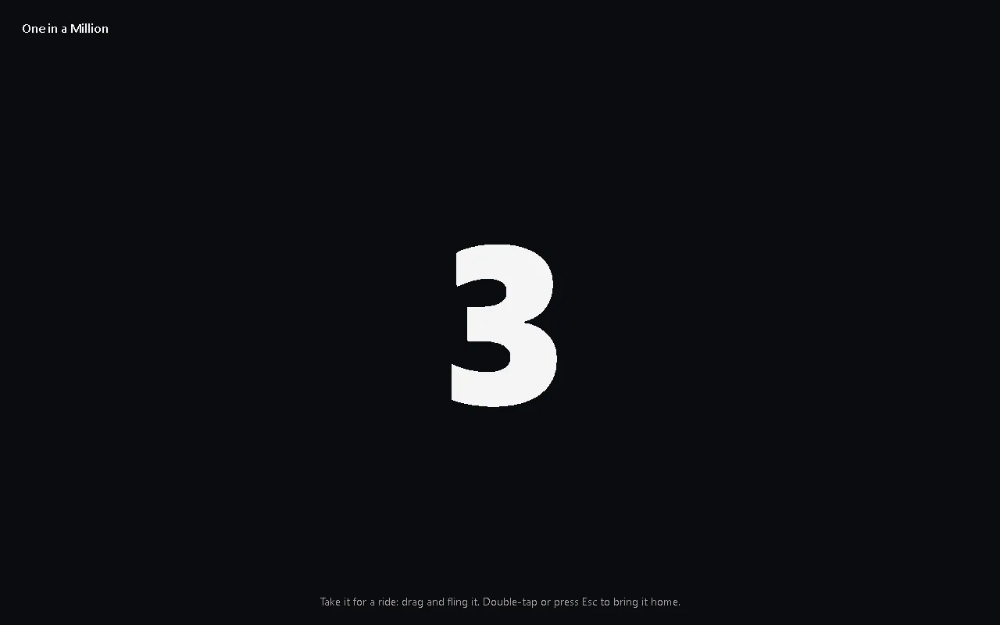
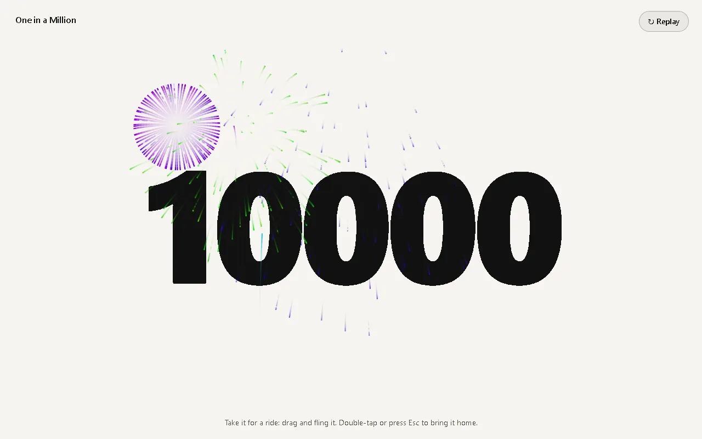

<div align="center">

# One in a Million

**Take a number. Every visitor gets a unique one, in order, until all 1,000,000 are gone.**

[](https://github.com/ThevinduFernando2003/one-in-a-million/actions/workflows/ci.yml)
[](https://one-in-a-million-nine.vercel.app)


### ▶ [one-in-a-million-nine.vercel.app](https://one-in-a-million-nine.vercel.app)




</div>

## What it is

A tiny web app with one rule and a hard engineering problem behind it:

- Open the page and you get the next number.
- Refresh while nobody else has taken one since, and you keep yours.
- If someone else took a number in the meantime, a refresh gives you a new one.
- **No two visitors can ever hold the same number**, and number 1,000,001 is never issued, even
  when thousands of people arrive at the same moment on serverless infrastructure.

Along the way:

- **Prime-based theme:** the page flips between dark and light every time the number is prime.
- **Milestone celebrations:** star bursts, confetti, fireworks, a golden "legendary" tier and a
  one-in-a-million finale.
- **Physics:** fling the number around the screen and watch it bounce.

|                                       Fireworks (every 10,000th)                                       |                                          Legendary (every 100,000th)                                           |
| :----------------------------------------------------------------------------------------------------: | :------------------------------------------------------------------------------------------------------------: |
|  |  |
|                                   **The finale (number 1,000,000)**                                    |                                                   **Mobile**                                                   |
|               |                                 |

### Highlights

- **Lock-free and correct under concurrency.** A single atomic Redis Lua script issues every
  number. There are no mutexes and no deadlocks, and a strict total order is guaranteed.
- **Proven, not promised.** 128 unit and real-Redis integration tests, plus an HTTP stress test
  (50 → 500 → 5,000 simultaneous visitors, and a race for the last 100 numbers) on every push.
- **Never burns numbers on bots.** The page is a static shell. Link previews, crawlers and
  prefetches never allocate.
- **Accessible and fast.** Screen-reader announcements, keyboard controls and reduced-motion
  alternatives. Lighthouse 100/100/100/100 on desktop.

**Stack:** Next.js 16 (App Router) · TypeScript (strict) · Tailwind CSS 4 · Upstash Redis
(`@upstash/redis`, `@upstash/ratelimit`) · `canvas-confetti` · Vitest · ESLint · Prettier ·
Vercel.

---

## How allocation works (lock-free) and why it can't produce duplicates

Vercel runs many stateless function instances at once, so nothing in a process (no memory,
module variables or files) can hold allocation state. The **only** source of truth is two Redis
keys, changed by **one Lua script** ([lib/allocate.ts](lib/allocate.ts)):

```lua
-- KEYS[1] = "{oiam}:counter"   KEYS[2] = "{oiam}:last_owner"
-- ARGV[1] = visitorId          ARGV[2] = maxTokens (1000000)
local cur = tonumber(redis.call('GET', KEYS[1]) or '0')
local owner = redis.call('GET', KEYS[2])
if cur > 0 and owner == ARGV[1] then
  return {cur, 0}            -- still the latest holder: same number
end
if cur >= tonumber(ARGV[2]) then
  return {-1, 0}             -- sold out
end
local n = redis.call('INCR', KEYS[1])
redis.call('SET', KEYS[2], ARGV[1])
return {n, 1}                -- newly issued
```

**Why this is correct**

- **Atomicity without locks.** Redis executes commands, and each Lua script in full, on a single
  thread. While the script runs, no other command can interleave. So every allocation runs as one
  indivisible step, and all allocations form a single **total order**. There are no mutexes,
  `SETNX` loops or row locks, so deadlock is impossible: no request ever waits on another request.
  They queue in Redis's command stream, which always makes progress.
- **Uniqueness.** A number is created only by `INCR`. Inside that total order, each `INCR` returns
  the previous value plus one, so no two `INCR`s can return the same value. The "same number" path
  re-confirms the number to the **one** visitor recorded as its owner. A visitor can only see a
  number that `INCR` handed to that exact visitor id.
- **Hard ceiling.** The `cur >= max` check and the `INCR` run in the same atomic step, so no
  interleaving can push the counter past the limit. `MAX_TOKENS` is clamped to 1,000,000 in code
  ([lib/config.ts](lib/config.ts)), and the server also refuses to display any newly issued number
  above the limit (`parseReply`). Number 1,000,001 cannot be issued even with a misconfigured
  environment.
- **Same slot.** Both keys share the hash tag `{oiam}`, so they live in the same cluster slot,
  which multi-key scripts require.
- **No local fallback.** If Redis fails (unreachable, timeout, unexpected reply), the API returns
  **503** and the UI shows an error. It never shows a guessed number.

### Fairness and order

"Fair" means **arrival order at the atomic counter**. Numbers are issued in the order allocation
scripts reach Redis, and the request that reaches Redis first gets the lower number. Network
jitter between a browser and Redis is outside anyone's control, so two people who click at "the
same moment" are ordered by whose request reaches Redis first. That order is final and
consistent. The stress test checks it: consecutive bursts produce consecutive, non-overlapping
ranges.

### Concurrent requests from the same visitor

Two tabs, a double refresh or a retry all carry the same `visitorId` cookie. Their scripts still
run one after another:

1. The first one finds `owner ≠ me`, runs `INCR` → `n`, and records `owner = me`.
2. The second one finds `owner == me` and `cur == n`, so it returns `n` without incrementing.

Twenty simultaneous requests from one visitor therefore produce **one** number, with exactly one
response saying `isNew: true`. This is tested against real Redis and over HTTP.

The only way the same visitor gets a second number is the rule itself: if **someone else's**
script ran in between, the visitor is no longer the latest holder and correctly gets a new number.

### Idempotent retries

The browser retries failed requests (network errors, 429, 5xx) up to 5 attempts, with
exponential backoff and jitter ([lib/token-client.ts](lib/token-client.ts)). A retry carries the
same cookie, so if the first attempt was actually processed and only the response was lost, the
owner check returns the **same** number instead of burning a new one.

Every attempt, even the very first request of a first-time visitor, already carries an identity:
[proxy.ts](proxy.ts) sets the cookie on the page load itself, which doesn't allocate anything.

**Honest limit.** If a response is lost **and** another visitor takes a number before the retry
arrives, the retry is (by the rules) a new request and gets a new number. The earlier number then
goes unseen. This is inherent to any at-least-once network protocol. To make it rare, the server
waits up to 20s for Redis rather than giving up early, because abandoning a request Redis is still
processing is exactly what creates such a gap. The browser waits up to 35s per attempt. Under
heavy load the page gets slower, not wrong. The stress test checks that, in practice, the Redis
counter exactly equals the number of numbers actually delivered.

### Visitor identity

- On first contact, the server sets `oiam_vid = crypto.randomUUID()` in an **httpOnly, Secure,
  SameSite=Lax** cookie valid for **1 year** (refreshed on every allocation).
- The browser never sends, sees or controls a number. It only carries the opaque id, and the
  server decides what that id holds. A forged or random id is just a new visitor.
- **Known limits.** Identity is a cookie, so incognito windows, other browsers, other devices and
  cleared cookies all count as new visitors and will take new numbers. This is expected. A first
  visit in two tabs opened at the exact same instant, before either has a cookie, can mint two
  identities, so one of those tabs ends up holding a number nobody will see again.

### Not burning numbers on non-humans

- The page is a **static shell**, prerendered at build time. Rendering it never allocates. Link
  previews (WhatsApp, Discord, Slack, …), crawlers and prefetches get HTML only.
- A number is requested only by JavaScript in a real browser. A tiny inline script in `<head>`
  starts the `POST /api/token` while the HTML is still parsing, which is faster than waiting for
  hydration, and React picks up the result.
- The API rejects obvious bots and preview fetchers by User-Agent, requires a matching `Origin`
  (plus `Sec-Fetch-Site: same-origin` when the browser sends it) and an empty JSON body, and only
  accepts `POST` (`GET` returns 405).
- A per-IP rate limit (`@upstash/ratelimit`, sliding window of **300 requests / 10 s**, set with
  `RATE_LIMIT_PER_10S`) is generous enough that 50 friends behind one Wi-Fi IP are never blocked.
- Responses are `Cache-Control: no-store`, and the route exports `dynamic = 'force-dynamic'`.

These filters protect the number supply. Correctness never depends on them.

---

## API

`POST /api/token` with body `{}` (or empty) and `Content-Type: application/json`.

**200**:

```json
{
  "number": 12345,
  "isNew": true,
  "theme": "light",
  "milestone": null,
  "soldOut": false
}
```

| field       | meaning                                                                                                                                      |
| ----------- | -------------------------------------------------------------------------------------------------------------------------------------------- |
| `number`    | the visitor's number. `null` only when `soldOut` is true and the visitor holds none.                                                         |
| `isNew`     | `true` only when this request issued a new number                                                                                            |
| `theme`     | `"dark"` if π(number) is even, otherwise `"light"`                                                                                           |
| `milestone` | `null` \| `"hundred"` \| `"thousand"` \| `"tenThousand"` \| `"hundredThousand"` \| `"million"` (highest tier only)                           |
| `soldOut`   | `true` when all numbers are taken and this visitor didn't get one. The holder of 1,000,000 keeps seeing their number, with `soldOut: false`. |

**Errors** use the shape `{ "error": string, "code": string }`:

| status | code                                  | when                                                            |
| ------ | ------------------------------------- | --------------------------------------------------------------- |
| 400    | `bad_request`                         | wrong content type, non-empty or invalid body                   |
| 403    | `forbidden`                           | bot/preview User-Agent, missing or foreign `Origin`, cross-site |
| 413    | `payload_too_large`                   | body over 256 bytes                                             |
| 429    | `rate_limited`                        | per-IP limit exceeded (with `Retry-After`)                      |
| 503    | `redis_unavailable` / `misconfigured` | Redis down, slow or not configured (with `Retry-After`)         |

---

## UI

- **Layout.** The wordmark sits in the top-left. The number is centred, bold, in plain integer
  form, with tabular figures. Its size uses `clamp()` and scales with the digit count, so short
  numbers fill a phone screen and 7 digits still fit.
- **Prime theme.** The theme flips at every prime: dark when π(n) is even. π(n) comes from a
  Sieve of Eratosthenes up to 1,000,000 (`Uint32Array`, built once per server instance), and the
  API returns the theme. The static HTML starts in a **neutral** palette, so the wrong theme never
  flashes, and the change animates smoothly.
- **Milestones.** Exactly one tier plays, the highest that applies, and only when the number is
  newly issued. A Replay button is always shown for milestone numbers. The celebration code is
  lazy-loaded.

  | tier              | effect                                                                                             |
  | ----------------- | -------------------------------------------------------------------------------------------------- |
  | ×100              | gold and white **star burst**                                                                      |
  | ×1,000            | **full-screen confetti** (central blast plus side cannons)                                         |
  | ×10,000           | **fireworks show**: rockets with trails, then peony, ring, willow and double-ring bursts           |
  | ×100,000          | **legendary**: aurora over a galaxy, rising gold motes, gold glow on the number, "LEGENDARY" title |
  | exactly 1,000,000 | **finale**: all of the above plus "You are one in a million"                                       |

  With `prefers-reduced-motion`, a calm static banner shows instead.

- **Draggable number.** Drag it with mouse, touch or pen (Pointer Events). When you let go it
  keeps its fling velocity, slows with friction, bounces off the viewport edges, and
  squashes-and-stretches.
  - **Return to centre:** double-click, double-tap, `Esc` or `Home` springs it back.
  - **Keyboard:** arrow keys nudge it (`Shift` for bigger steps).
  - **Implementation:** the physics runs in `requestAnimationFrame` and writes only `transform`.
    Text selection and page scroll are disabled while dragging. The pure physics lives in
    [lib/physics.ts](lib/physics.ts).
- **Accessibility.** An `aria-live="polite"` region announces "Your number is 12345". Focus rings
  are visible. Contrast passes AA in both themes. Everything works without animations.

## Search engines (SEO)

- **Indexable static page** with a title, description, keywords, a canonical URL, Open Graph and
  Twitter cards, and schema.org `WebApplication` structured data (JSON-LD).
- **`/sitemap.xml` and `/robots.txt`** are generated by Next.js. robots.txt allows the page and
  disallows `/api/`.
- **Crawlers that run JavaScript** (Googlebot, Bingbot, …) never request a number. Instead of an
  error they see a short description of the site, and that is what gets indexed.
- **Google Search Console:** add a URL-prefix property for the site, choose the "HTML tag" method,
  put the token in the `GOOGLE_SITE_VERIFICATION` env var on Vercel, redeploy, verify, then submit
  `sitemap.xml`.

## Security and operations

- **Security headers** in [next.config.ts](next.config.ts):
  - CSP with `frame-ancestors 'none'`
  - `X-Content-Type-Options: nosniff`
  - `Referrer-Policy`
  - `X-Frame-Options: DENY`
  - COOP / CORP
  - `Permissions-Policy`
  - HSTS (on Vercel)
- **CSP trade-off.** The CSP allows inline scripts and styles. Nonces would force every page view
  to be dynamically rendered, while the spec (and the bot-safety design) wants a static shell.
  Next.js also inlines small bootstrap scripts into static HTML. The page never renders
  user-supplied HTML, and `connect-src 'self'` keeps the browser talking only to this origin.
- **Secrets.** All environment variables are server-only (none use the `NEXT_PUBLIC_` prefix).
- **Logs.** Structured one-line JSON logs: `token.allocate` with `{number, isNew, soldOut,
latencyMs}`, plus `token.rejected`, `token.error` and `token.ratelimit_error`. They contain no
  visitor id, IP, cookie or User-Agent.

---

## Run locally

Requirements: Node 20.9+ (tested on 22), Docker.

```bash
npm install
cp .env.example .env.local        # points at the local SRH container below
npm run redis:up                  # Redis 7 + serverless-redis-http (SRH) on :8079
npm run dev                       # http://localhost:3000
```

SRH speaks the Upstash REST protocol, so the unmodified `@upstash/redis` client talks to a real
local Redis, fully offline.

### Environment

| variable                                             | purpose                                                                     |
| ---------------------------------------------------- | --------------------------------------------------------------------------- |
| `UPSTASH_REDIS_REST_URL`, `UPSTASH_REDIS_REST_TOKEN` | Upstash REST credentials                                                    |
| `KV_REST_API_URL`, `KV_REST_API_TOKEN`               | fallbacks (names injected by the Vercel Marketplace Upstash integration)    |
| `MAX_TOKENS`                                         | ceiling, default and maximum 1000000                                        |
| `RATE_LIMIT_PER_10S`                                 | per-IP limit, default 300                                                   |
| `ALLOWED_ORIGINS`                                    | optional extra origins allowed to POST (comma-separated)                    |
| `SITE_URL`                                           | optional canonical URL for Open Graph (defaults to Vercel's production URL) |
| `GOOGLE_SITE_VERIFICATION`                           | optional Google Search Console verification token (HTML-tag method)         |

### Deploy to Vercel

The live instance is at https://one-in-a-million-nine.vercel.app. To run your own:

1. Import the repo into Vercel.
2. Add an Upstash Redis database (Marketplace → Upstash). This injects `KV_REST_API_*`, or you can
   set the `UPSTASH_*` variables yourself.
3. Deploy.
4. Just before launch, reset the counter:
   `NODE_ENV=production RESET_CONFIRM=yes npm run reset -- --force`, with the production
   credentials in your environment.

### Reset / seed the counter

```bash
RESET_CONFIRM=yes npm run reset                  # counter → 0, next visitor gets 1
RESET_CONFIRM=yes npm run reset -- --to 999998   # rehearse the sold-out boundary
```

The reset script:

- refuses to run without `RESET_CONFIRM=yes`
- refuses to run with `NODE_ENV=production` unless `--force` is passed
- sets the counter and clears the owner atomically (`MULTI`/`EXEC`)

---

## Tests

The whole suite, `npm run verify`, runs in [GitHub Actions](.github/workflows/ci.yml) on every push
and pull request.

```bash
npm run redis:up          # required for integration + stress
npm run test:unit         # sieve / π(n) / theme, milestones, physics, guards, client retries
npm run test:integration  # allocation rules + route handler against real Redis (via SRH)
npm run build && npm run stress:local   # HTTP stress test against the production build
npm run verify            # everything: lint, format, types, all tests, build, stress
```

- **Unit:**
  - sieve and π(n), against known values and a trial-division cross-check
  - the theme rule (1→dark, 2→light, 3→dark, 4→dark, 5→light, 6→light, 7→dark)
  - milestone tiers, including 0, 99,999 and 999,999
  - physics: bounds, fling velocity, bounces, spring settling, squash and stretch, double tap,
    nudges
  - request guards and identity
  - client retry, backoff and preload behaviour
- **Integration (real Redis):**
  - A/B scenario: A→3, A→3, B→4, A→5
  - sold-out boundary: 999,998 → 999,999 → 1,000,000 → sold out
  - 500 concurrent distinct visitors
  - 20 concurrent requests from the same visitor
  - 50 visitors racing for the last 10 numbers
  - script-cache flush recovery
  - Redis down gives an error, never a number
  - route guards, input validation, cookie flags, `no-store`, the rate limiter returning 429, and
    the `KV_REST_API_*` fallback
- **Stress ([scripts/stress.ts](scripts/stress.ts) /
  [scripts/stress-local.ts](scripts/stress-local.ts)):**
  - phases: 50, then 500, then 5,000 simultaneous POSTs with distinct cookies; then 20
    simultaneous POSTs with **one** cookie; then 500 visitors racing for the last 100 numbers
  - assertions: all numbers unique, contiguous, within the limit and in arrival order; the Redis
    counter equals the numbers delivered (nothing burned); exactly 100 issued and 400 sold out in
    the race
  - output: a summary table
  - `stress:local` starts the production server itself, and refuses to run against any non-local
    Redis
  - `npm run stress` targets an already running app (`BASE_URL=…`). Raise `RATE_LIMIT_PER_10S`
    for it, because all stress traffic comes from one IP.

**Stress transport.** Each phase launches all requests at the same instant, and all of them are
in flight together. They travel over a pool of 256 keep-alive connections (`STRESS_CONNECTIONS`,
`0` = one socket per request), the way a CDN or load balancer fronts serverless functions. Without
this, the OS loopback stack is the bottleneck, not the app: on the Windows development machine, a
bare Node HTTP server dropped about half of 500 simultaneous TCP connects. Like the real browser
client, the harness retries transport errors and 429/5xx with the same cookie. Any retry that
burned a number would still fail the gap and counter checks.

## Project layout

```
app/          page (static shell), layout (metadata, preload script), api/token/route.ts,
              opengraph-image, robots, icon
components/   TokenDisplay (state machine), DraggableNumber, Celebrations (lazy), fx/* (canvas effects)
lib/          redis, allocate (Lua script), primes, milestones, physics, guards, identity,
              token-client, config, log, api-types
proxy.ts      sets the visitor cookie on page load (never allocates)
scripts/      stress.ts, stress-local.ts, stress-core.ts, reset.ts, ops.ts
tests/        unit/, integration/
```
